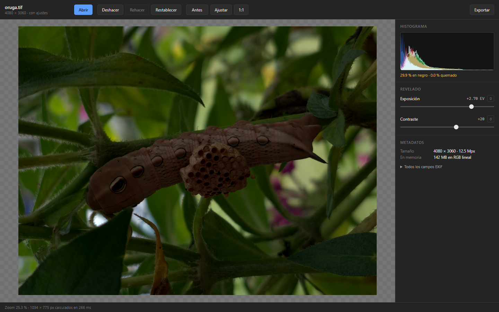

# PhotoForge

Editor de fotografía no destructivo para Windows. Abre una foto, la revela sin
tocar nunca el archivo original y la exporta.

Escrito en **Rust** con **Tauri 2**. El núcleo de imagen es Rust puro y la
interfaz es TypeScript sin framework.

Este README explica **por qué** está hecho así. El qué se lee en el código.

---

## Qué hace hoy

Abre JPG, PNG y TIFF de 8 o 16 bits. Los pinta en un lienzo con zoom y
desplazamiento, enseña sus metadatos EXIF y su histograma, aplica exposición y
contraste de forma no destructiva, compara el antes y el después manteniendo
pulsado un botón, deshace y rehace, y exporta a JPEG, PNG o TIFF de 16 bits.

Lo que **no** hace todavía: abrir RAW desde la aplicación, capas, máscaras,
selecciones y guardar proyectos. El apartado [Lo que falta](#lo-que-falta) dice
en qué orden y por qué.

---

## La prueba de riesgo: ¿se puede decodificar RAW en Rust, en Windows?

Todo el proyecto depende de esa respuesta, así que fue lo primero que se
comprobó, antes de escribir una línea de la aplicación. Medido el **14 de
noviembre de 2026** en un Windows 11 con el toolchain de MSVC.

### Lo que hay de verdad en crates.io

| Biblioteca | Versión | Publicada | Licencia | Estado |
|---|---|---|---|---|
| [`rawler`](https://crates.io/crates/rawler) | 0.8.0 | 2026-08-30 | LGPL-2.1 | **La elegida.** Rust puro. 227.000 descargas. Es el motor de [DNGLab](https://github.com/dnglab/dnglab), que convierte RAW a DNG desde 2021 |
| [`flashraw`](https://crates.io/crates/flashraw) | 0.3.0 | 2026-11-14 | MIT/Apache-2.0 | Prometedora y demasiado nueva. Nació el 25 de octubre de 2026 y **las tres versiones anteriores están retiradas**. 2.000 descargas |
| [`rawloader`](https://crates.io/crates/rawloader) | 0.37.2 | 2026-08-15 | LGPL-2.1 | El antecesor de `rawler`, del mismo entorno. Menos formatos |
| [`libraw-sys`](https://crates.io/crates/libraw-sys) | 0.1.1 | **2015-11-05** | — | Abandonada hace once años. Depende de la caja `gcc`, que ya ni existe con ese nombre, y busca la biblioteca con `pkg-config`: en Windows no hay por dónde cogerla |

Las dos candidatas **compilan en Windows con MSVC sin pelearse**: son Rust
puro, no hace falta vendorizar LibRaw, ni `pkg-config`, ni una DLL al lado del
ejecutable. Esa era la pregunta de verdad, y la respuesta es que sí.

### Qué pasa con el DNG del Samsung Galaxy S25 Ultra

Medido sobre cinco archivos de Expert RAW, de 13 a 23 MB:

```text
samsung Galaxy S25 Ultra
  decodificado en 504 ms
  4080×3060, 3 componentes por píxel, 16 bits
  mosaico: NO, el archivo ya viene lineal — demosaico sería un error
  niveles de negro: 12 valores (patrón 2×2, 3 canales)
  niveles de blanco: [65535, 65535, 65535]
```

Confirmado: **el DNG de Expert RAW es lineal de 16 bits y no lleva mosaico de
Bayer**. `rawler` lo marca como `LinearRaw` y su propio revelador se salta el
demosaico sin que haya que decirle nada, así que el riesgo de destrozar el
archivo aplicándole un demosaico que no toca no existe.

### Y el fallo que apareció por el camino

El primer revelado salió **enteramente blanco**. La causa no era la
decodificación:

`RawImage::apply_scaling`, que es lo que normaliza los valores a 0..1, llama a
`correct_blacklevel(datos, negros, blancos)`. Esa función compara
`negros.len()` con `blancos.len()` antes de hacer nada. El DNG del S25 Ultra
trae **12 niveles de negro** (un patrón de 2×2 por 3 canales) y **3 de
blanco**. Como 12 ≠ 3, la función cae en su rama final, escribe un
`log::warn!` y **vuelve sin tocar un solo píxel**.

Nadie ve ese aviso: una aplicación de escritorio sin `env_logger` montado no lo
saca por ningún sitio. Los valores siguen entre 0 y 65.535 cuando el resto de
la cadena los espera entre 0 y 1, y al pintar todo lo que pasa de 1 se recorta
a blanco. Los cinco archivos de prueba dan 12 contra 3, así que les pasa a
todos.

Por eso PhotoForge **normaliza por su cuenta**, aplicando el patrón de negro en
mosaico, y no se apoya en `apply_scaling`. Está en
[`crates/pf-image/examples/sonda_raw.rs`](crates/pf-image/examples/sonda_raw.rs),
con el porqué escrito al lado del código.

### El nivel de blanco declarado no es el de la escena

Máximos crudos de los cinco archivos: **1.334, 2.139, 3.834, 9.214 y 29.352**,
sobre un nivel de blanco declarado de 65.535. Varían con la escena, así que
65.535 sí es el techo bueno: esas fotos sencillamente no llegan a quemarse.

La consecuencia práctica: **en luz lineal, una foto bien expuesta se ve
oscura.** No es un fallo de la normalización, es lo que significa trabajar en
lineal, y es el motivo de que un revelador necesite una curva de tono. El
ejemplo lo avisa cuando detecta el caso en vez de dejar que parezca un error.

### Correr la sonda

```bash
cargo run -p pf-image --example sonda_raw --release -- foto.dng salida.tif
```

Informa de lo que trae el archivo, lo normaliza, lo revela a RGB lineal y
escribe un TIFF de 16 bits pasando por los mismos tipos que usa la aplicación.

### Por qué `rawler` aunque sea LGPL-2.1

PhotoForge es MIT y `rawler` es LGPL-2.1. La LGPL obliga a que quien reciba el
binario pueda reenlazarlo contra otra versión de la biblioteca; con un
ejecutable de Rust, que enlaza estáticamente, eso significaría entregar los
objetos. Aquí se cumple sola porque **el código fuente entero está publicado y
cualquiera puede recompilar**.

Si algún día PhotoForge se vendiera cerrado, esto habría que rehacerlo: o
`flashraw` (MIT, mucho más verde) o `rawler` en un proceso aparte. Queda dicho
para que la decisión no sorprenda a nadie más adelante.

---

## Las decisiones y sus motivos

### Por dentro, una imagen es RGB lineal en `f32`. Siempre

No hay un tipo para 8 bits y otro para 16: abrir un JPEG consiste en
convertirlo a RGB lineal en coma flotante.

**Lineal** porque los valores de un JPEG no son luz, son luz pasada por la
curva de sRGB. Subir la exposición multiplicando esos valores no duplica la
luz: duplica un número que representa la luz de forma torcida, y el resultado
tiene los medios tonos lavados. En lineal, un paso de exposición es
literalmente multiplicar por dos, y el código de la operación cabe en tres
líneas.

**`f32`** porque un editor no destructivo encadena operaciones y con enteros
cada una redondea. Y porque la exposición puede sacar valores por encima de
1,0 que una corrección posterior devuelve al rango: con `u16` ese brillo se
habría recortado para siempre.

**Tres canales y no cuatro** porque una fotografía no tiene transparencia. Un
canal alfa que siempre vale 1 cuesta un tercio más de memoria —200 MB en una
foto de 50 Mpx— para nada.

El precio de todo esto es la memoria: una foto de 12,5 Mpx ocupa **142 MB**.
Se paga a cambio de que ninguna operación degrade la imagen.

### El contraste es la excepción, y por eso lleva su explicación encima

Se aplica en espacio perceptual y no en lineal. En luz lineal el gris medio
está en 0,18 y las sombras se amontonan por debajo de 0,05: estirar alrededor
de 0,18 movería muchísimo las luces y casi nada las sombras, así que el primer
20 % del deslizador no parecería hacer nada y el último quemaría el cielo. Un
deslizador tiene que sentirse parejo. El código está en
[`operacion.rs`](crates/pf-document/src/operacion.rs) con el razonamiento
completo.

### El orden de las operaciones es fijo, no el de uso

Si la lista se llenara por orden de uso, subir la exposición y luego el
contraste daría una foto distinta que hacerlo al revés, y el usuario no tendría
forma de saber por qué. Cada operación declara su `orden()` y la lista se
ordena sola: primero se coloca la foto donde debería haber estado (exposición)
y después se interpreta (contraste).

### Primero se recorta, después se revela

Una foto de 50 Mpx no cabe en un lienzo de 1,4 Mpx. Si cada movimiento del
deslizador recalculara los 50 millones de píxeles para enseñar 1,4 millones, se
tiraría el 97 % del trabajo.

Así que el lienzo **no tiene la foto**: tiene un zoom, un punto central y el
tamaño de la ventana. Con eso calcula qué rectángulo se ve y a qué resolución,
y se lo pide a Rust ya revelado. El coste deja de depender del tamaño de la
foto y pasa a depender del tamaño de la ventana.

Hay que decirlo en voz alta: lo que se ve en pantalla está calculado sobre
menos píxeles que el archivo final. Para exposición y contraste, que tratan
cada píxel por separado, la aproximación es exacta. Para lo que venga después
—enfoque, reducción de ruido— no lo será, y habrá que avisarlo en la interfaz.

### El puente con la interfaz manda bytes, no JSON

Un lienzo de 1.600 × 900 en RGBA son 5,7 MB. En JSON, con un número y una coma
por byte, pasarían de 20 MB de texto que construir, copiar, enviar y analizar,
treinta veces por segundo. Por eso `renderizar` devuelve
`tauri::ipc::Response`, que manda los bytes en crudo y llega al navegador como
un `ArrayBuffer` que `putImageData` usa casi sin tocarlo.

### Tres cajas, no veinte

El plan tiene veinte. Hoy hay tres:

- **`pf-core`** — el error y los tipos que todas comparten.
- **`pf-image`** — los píxeles: carga, color, muestreo, histograma,
  metadatos, exportación.
- **`pf-document`** — el documento no destructivo: el original intacto más la
  lista de operaciones.

Una caja es un sitio más donde buscar, y veinte cajas vacías son veinte sitios
donde buscar. Se parten cuando duela, no antes.

Lo que sí justifica que haya tres y no una: la aplicación de Tauri se compila
como `cdylib` y eso contagia a todo lo que viva dentro. Con el núcleo fuera,
`cargo test -p pf-image` tarda **segundos** en vez de los más de cinco minutos
que tarda la aplicación entera.

### Sin framework en la interfaz

PhotoForge tiene una pantalla. Toda su complejidad está en el lienzo —que se
pinta con `putImageData` y al que un DOM virtual no le aporta nada— y en Rust.
Un framework añadiría un paso de compilación, un modelo mental y doscientos
kilobytes para resolver un problema que no se tiene. Lo que hacía falta de
verdad era no escribir `document.createElement` cuarenta veces, y eso cabe en
[un archivo de setenta líneas](src/lib/dom.ts).

### Todo gris, y sin tema claro

No es estética. En un editor de fotografía, la interfaz es el fondo contra el
que el ojo juzga el color de la foto: un panel azulado hace que la foto parezca
cálida y un fondo claro la hace parecer oscura. Todos los grises son **neutros**
—R, G y B valen lo mismo— y el que rodea al lienzo es **#767676**, que es el
18 % de reflectancia: el gris medio fotográfico, el de una carta gris.

### El archivo original no se sobrescribe nunca

Al exportar, PhotoForge compara la ruta de destino con la del archivo abierto y
se niega si son la misma. Es el peor fallo posible de este programa y ocurre
con un solo despiste en el diálogo de guardar.

Y mientras se escribe, se escribe a un archivo `.pf-parcial` que solo se
renombra al terminar. Si el programa se cierra a mitad de un TIFF de 300 MB, en
el disco queda el archivo anterior entero en vez de uno a medias con el nombre
bueno, que es peor porque parece válido.

---

## Las cifras

Medidas con
[`cargo run -p pf-document --example revelar --release`](crates/pf-document/examples/revelar.rs)
sobre un TIFF de 16 bits de 4080 × 3060 (12,5 Mpx) salido de un DNG del S25
Ultra, con una vista de 1.600 × 900:

| Operación | Tiempo |
|---|---|
| Abrir el TIFF de 16 bits y pasarlo a RGB lineal | 85 ms |
| Muestrear la vista, sin revelar | 10 ms |
| **Vista revelada (lo que cuesta un movimiento del deslizador)** | **28 ms** |
| Pasar la vista a RGBA de 8 bits para el lienzo | 2,8 ms |
| Histograma rápido (786.000 muestras) | 26 ms |
| Histograma completo (1.040.000 muestras) | 198 ms |
| Revelar la foto entera para exportar | 177 ms |
| Escribir el JPEG de 12,5 Mpx | 255 ms |

Todas son del perfil de **publicación** (`--release`). En una compilación de
desarrollo la misma vista tarda unos 270 ms: el perfil `dev` de este proyecto
ya optimiza las cajas del núcleo (`opt-level = 3` para `pf-image` y
`pf-document`), pero no la aplicación, así que `npm run tauri dev` se nota
lento y no es el número que hay que mirar.

Los 28 ms de la vista revelada son el número que importa: dan unos **35 cuadros
por segundo** arrastrando un deslizador, y **no suben si la foto es más
grande**, porque dependen del tamaño de la ventana.

Y por eso el histograma tiene dos modos: los 198 ms del completo son
inaceptables sesenta veces por segundo, así que mientras se arrastra se pide el
rápido y el completo solo al soltar. El completo es el único que puede contar
bien el recorte; el rápido, al promediar píxeles, puede perder de vista cuatro
píxeles quemados.

La decisión de **no usar la GPU todavía** sale de estas cifras: con 28 ms por
cuadro en CPU, `wgpu` serían miles de líneas y una superficie que falla
distinto en cada equipo para arreglar algo que de momento no está roto. Se
medirá otra vez cuando haya operaciones que miren a los vecinos.

---

## Montarlo desde cero

**1. Rust 1.89 o superior**, con el toolchain de MSVC. Desde
[rustup.rs](https://rustup.rs), y después:

```bash
rustup default stable-x86_64-pc-windows-msvc
```

**2. Node.js 20.19 o superior** (o 22.12 o superior). Ese escalón lo pone
Vite 8; con un Node anterior la instalación solo suelta un aviso `EBADENGINE`
que se pierde entre el ruido y el fallo de verdad aparece mucho después.

**3. Las herramientas de C++ de Visual Studio.** En el instalador de Visual
Studio Build Tools, la carga de trabajo **«Desarrollo para el escritorio con
C++»** (*Desktop development with C++*), que trae MSVC v143 y el Windows SDK.
Aquí no se compila nada en C —ese era justamente el objetivo al elegir
`rawler`—, pero el enlazador de Rust para Windows sí es el de MSVC.

**4. WebView2 Runtime.** Viene de serie en Windows 11.

Y ya:

```bash
npm install
```

```bash
npm run tauri dev
```

La primera compilación baja y compila unas 500 cajas: cuenta con varios
minutos. `npm run tauri build` tarda siempre, porque el perfil de publicación
usa LTO completo y una sola unidad de codegen.

> **Al compilar, cierra antes la aplicación.** Si está abierta, Windows tiene
> bloqueado el `.exe`, la compilación falla al reemplazarlo **y aun así
> termina con código de salida 0**, dejando los instaladores de la vez
> anterior. Compara las fechas de los archivos para saber si la compilación es
> real.

### Las pruebas

```bash
cargo test
```

46 pruebas: 43 del núcleo, que corren en centésimas de segundo porque no
arrastran Tauri, y 3 de integración que recorren una sesión entera —abrir,
ajustar, comparar, deshacer, exportar— contra el estado real de la aplicación.

Solo el núcleo, que es lo que se toca a menudo:

```bash
cargo test -p pf-core -p pf-image -p pf-document
```

---

## Cómo está repartido

```text
crates/
  pf-core/        Error, Dimensiones, Region
  pf-image/       Imagen (RGB lineal f32)
    color.rs        sRGB <-> lineal, con sus tablas
    carga.rs        JPG, PNG, TIFF -> Imagen
    muestreo.rs     el recorte y escalado de la vista
    histograma.rs   256 columnas y el recuento de recorte
    metadatos.rs    EXIF
    exportar.rs     JPEG, PNG, TIFF de 16 bits
    examples/sonda_raw.rs    la prueba de riesgo del RAW
  pf-document/    Documento = original + lista de operaciones
    operacion.rs    exposición y contraste
    examples/revelar.rs      el banco de medidas

src-tauri/        la cáscara: ventana, estado y comandos
  src/comandos.rs   lo que la interfaz puede pedir
  src/estado.rs     el documento abierto
  tests/flujo.rs    una sesión entera sin ventana

src/              la interfaz
  lib/api.ts        la frontera con Rust, toda en un archivo
  ui/lienzo.ts      zoom, desplazamiento y pintado
  ui/panel.ts       histograma, deslizadores y metadatos
  ui/barra.ts       la barra de herramientas
```

La regla que mantiene esto en pie: **en `src-tauri` no se escribe ni un cálculo
sobre píxeles**. Si hace falta uno, su sitio es `pf-image`.

---

## Atajos de teclado

| Tecla | Qué hace |
|---|---|
| `Ctrl+O` | Abrir |
| `Ctrl+E` | Exportar |
| `Ctrl+Z` / `Ctrl+Y` | Deshacer / Rehacer |
| `0` | Ver la foto entera |
| `1` | Un píxel por píxel |
| `\` (mantener) | Enseñar el original |
| Rueda | Zoom anclado al cursor |
| Arrastrar | Desplazar |
| Doble clic | Ver la foto entera |

---

## Lo que falta

En el orden en que tiene sentido hacerlo, y con el motivo del orden:

1. **Abrir RAW desde la aplicación.** El camino está probado y medido; lo que
   falta es la curva de tono, sin la cual un RAW lineal se ve oscuro y
   parecería que algo va mal. Por eso no entra hasta que entre la curva.
2. **Más operaciones de revelado**: luces, sombras, blancos, negros,
   temperatura y tinte. Cuando sean ocho o diez, el enum `Operacion` empezará a
   molestar y será el momento de partirlo; hoy no.
3. **Guardar proyectos (`.pforge`).** El formato se definirá cuando la lista de
   operaciones esté asentada. Inventarlo ahora sería diseñar a ciegas, y
   cambiarlo después rompería los archivos de quien ya lo use.
4. **Capas y máscaras.** Aquí es donde el modelo de «una lista plana de
   operaciones» se queda corto y habrá que revisarlo de verdad.
5. **GPU**, si las cifras lo piden. Hoy no lo piden.

---

## Licencia

[MIT](LICENSE).

PhotoForge usa [`rawler`](https://github.com/dnglab/dnglab) (LGPL-2.1) en su
ejemplo de decodificación de RAW. El apartado de la prueba de riesgo explica
qué implica eso y qué habría que cambiar si el proyecto dejara de ser abierto.
